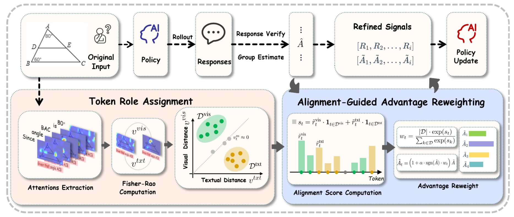
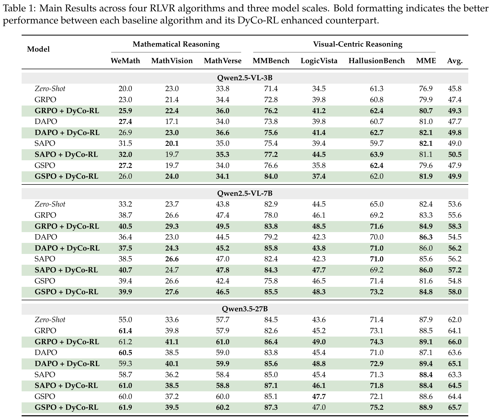

# DyCo-RL: Dynamic Cross-Modal Coordination for Visual Reasoning


<p align="center">
    🌐 <a href="" target="_blank">Blog</a> | 📃 <a href="https://arxiv.org/abs/2606.08035" target="_blank">Paper</a> | 🤗 <a href="https://huggingface.co/collections/LinYuanMo/dyco-rl" target="_blank">Model</a> |  🤗 <a href="https://huggingface.co/datasets/russwang/ThinkLite-VL-hard-11k" target="_blank">Training_Data</a> 

</p>


#### [Hangui Lin <sup>2</sup>](https://scholar.google.com/citations?user=ofF4kxIAAAAJ&hl=en), [Yan Shu <sup>1</sup>](https://shuyansy.github.io/), [Zhengyang Liang <sup>3</sup>](https://liang-zhengyang.github.io/), [Chi Liu <sup>4</sup>](https://scholar.google.com/citations?user=abmQYmYAAAAJ&hl=zh-CN), [Xiangrui Liu <sup>2</sup>](https://openreview.net/profile?id=~Minghao_Qin1),  [Minghao Qin <sup>2</sup>](https://lxrrrrrr.github.io/), [Teng Long <sup>1</sup>](https://scholar.google.com/citations?user=5Iv3ul0AAAAJ&hl=en), [Zheng Liu <sup>2</sup>](https://scholar.google.com/citations?user=k2SF4M0AAAAJ&hl=en), [Nicu Sebe <sup>1</sup>](https://scholar.google.com/citations?user=stFCYOAAAAAJ&hl=en)

<sup>1</sup> University of Trento, Italy, <br>
<sup>2</sup> Beijing Academy of Artificial Intelligence (BAAI), <br>
<sup>3</sup> Singapore Management University <br>
<sup>4</sup> IQuest Research <br>

<div align="center">

<div>
  <font size=4>
    <p>🎉  <b>We propose DyCo-RL, a novel approach that embeds dynamic, token-level cross-modal coordination into the RLVR framework.</b></p>
  </font>
</div>
</div>

Reinforcement Learning with Verifiable Rewards (RLVR) improves visual reasoning in Multimodal Large Language Models (MLLMs), but outcome-based rewards provide limited guidance on how individual tokens coordinate visual evidence and textual context. As a chain-of-thought unfolds, some tokens need to extract information from the image, while others need to anchor their reasoning to the preceding text. Our token-level attention analyses reveal that erroneous tokens often under-attend to the modality their role requires. Controlled interventions further show that role-aligned attention modulation can recover correct answers on previously erroneous samples.

We introduce **DyCo-RL**, an algorithm-agnostic approach that incorporates dynamic, token-level cross-modal coordination into RLVR. First, DyCo-RL measures the Fisher-Rao geodesic distance between consecutive attention distributions **within each modality**, using attention redistribution as a proxy to assign visually-oriented, text-oriented, or neutral roles. It then scores alignment using the attention mass allocated to the assigned modality, normalized across the response. These scores guide sign-aware advantage reweighting: higher alignment amplifies positive advantages and attenuates negative advantages more strongly, while neutral tokens retain the original sequence-level advantage.

Using **11K training examples**, experiments on **Qwen2.5-VL-3B/7B and Qwen3.5-27B** demonstrate gains with **GRPO, DAPO, SAPO, and GSPO**. DyCo-RL improves the average score across **seven benchmarks** spanning mathematical and visual-centric reasoning for every evaluated backbone-algorithm combination, with gains of up to **3.2 points**.


## 🛠️ Setup

```bash
conda create -n dyco-rl python=3.10
conda activate dyco-rl
bash setup.sh
```

## 💪🏻 Training

### 📚 GRPO/GSPO/SAPO/DAPO

1. Download the [ThinkLite-VL-hard-11k](https://huggingface.co/datasets/russwang/ThinkLite-VL-hard-11k) , and we refer to the image dir as `<your_image_root>`.
2. Change the `data_paths` and `image_folders` wthin the file in `run_scripts/` folder.
3. Run the training code in   `run_scripts/` folder.

### For your own data

<div style="text-align: justify;">

We support data loading the jsonl data  has the format as follows:

```json
{
  "id": 1,
  "image": "Clevr_CoGenT_TrainA_R1/data/images/CLEVR_trainA_000001_16885.png",
  "conversations": [
    {"from": "human", "value": "<image>What number of purple metallic balls are there?"},
    {"from": "gpt", "value": "0"}
  ]
}
```

If you want to use multi-image input, you can use the following format:

```json
{
  "id": 1,
  "image": ["Clevr_CoGenT_TrainA_R1/data/images/CLEVR_trainA_000001_16885.png", "Clevr_CoGenT_TrainA_R1/data/images/CLEVR_trainA_000001_16886.png"],
  "conversations": [
    {"from": "human", "value": "<image><image>What number of purple metallic balls in total within the two images?"},
    {"from": "gpt", "value": "3"}
  ]
}
```


<div style="text-align: justify;">

## 📊 Evaluation



- We  test the model using  [VLMEvalKit](https://github.com/open-compass/VLMEvalKit).You can test our benchmark using following code：
```bash
git clone https://github.com/open-compass/VLMEvalKit.git
conda activate your-env
cd VLMEvalKit
pip install -e .
python run.py  --data  xxxbench  --model Qwen2.5-VL-3B-Instruct  --verbose
```

## Citation
If you find this work useful for your research, please cite our paper :
```
@article{lin2026dyco,
  title={DyCo-RL: Dynamic Cross-Modal Coordination for Visual Reasoning},
  author={Lin, Hangui and Shu, Yan and Liang, Zhengyang and Liu, Chi and Liu, Xiangrui and Qin, Minghao and Long, Teng and Liu, Zheng and Sebe, Nicu},
  journal={arXiv preprint arXiv:2606.08035},
  year={2026}
}
```
